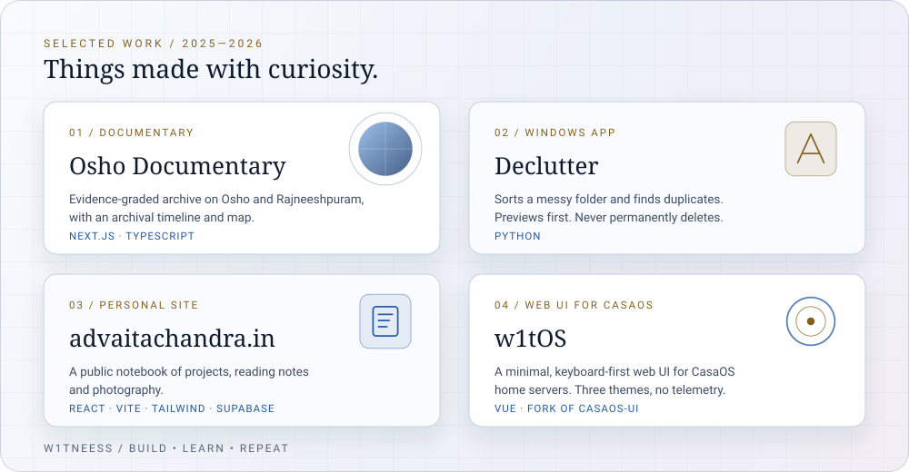

<picture><source media="(max-width: 600px) and (prefers-color-scheme: dark)" srcset="assets/hero-mobile-dark.svg"><source media="(max-width: 600px) and (prefers-color-scheme: light)" srcset="assets/hero-mobile-light.svg"><source media="(prefers-color-scheme: dark)" srcset="assets/hero-dark.svg"></picture>

 

 

[ABOUT](#about) &nbsp;·&nbsp; [SELECTED WORK](#selected-work) &nbsp;·&nbsp; [TOOLKIT](#toolkit) &nbsp;·&nbsp; [OUTSIDE THE EDITOR](#outside-the-editor)

---

## About

I'm a student and developer from India interested in the space between **software, philosophy, history and visual storytelling**.

I build websites, experiment with interfaces, and make tools around problems I encounter. This profile is a record of things made, ideas explored, and experiments still in progress.

<strong>A little more</strong>

I enjoy taking an idea from a rough thought to something usable. Most of my learning happens by building, breaking, investigating, and rebuilding.

I'm drawn to thoughtful interfaces, creative technology, and the details that make software feel considered.

## Selected work

<picture><source media="(max-width: 600px) and (prefers-color-scheme: dark)" srcset="assets/showcase-mobile-dark.svg"><source media="(max-width: 600px) and (prefers-color-scheme: light)" srcset="assets/showcase-mobile-light.svg"><source media="(prefers-color-scheme: dark)" srcset="assets/showcase-dark.svg"></picture>

- **Osho Documentary** — an evidence-graded interactive documentary on Osho and Rajneeshpuram, with an archival timeline and map. [Live&nbsp;↗&#xFE0E;](https://oshodocumentary.advaitachandra.in/) · [Code&nbsp;↗&#xFE0E;](https://github.com/w1tneess/osho-documentary)
- **Declutter** — a Windows app that sorts a messy folder, finds duplicates and large or old files, and previews every change first. It never permanently deletes. [Live&nbsp;↗&#xFE0E;](https://declutter.advaitachandra.in/) · [Code&nbsp;↗&#xFE0E;](https://github.com/w1tneess/declutter)
- **Personal website** — my public notebook for projects, reading notes and photography. [Visit&nbsp;↗&#xFE0E;](https://advaitachandra.in/) · [Code&nbsp;↗&#xFE0E;](https://github.com/w1tneess/advaita-website)
- **w1tOS** — a minimal, keyboard-first web UI for CasaOS home servers, with three themes and no telemetry. A fork of CasaOS-UI. [Code&nbsp;↗&#xFE0E;](https://github.com/w1tneess/w1tos-ui)
- **Command Deck** — a Class 10 exam and syllabus study dashboard on Cloudflare Workers and D1. [Code&nbsp;↗&#xFE0E;](https://github.com/w1tneess/command-deck)

[EXPLORE ALL REPOSITORIES ↗&#xFE0E;](https://github.com/w1tneess?tab=repositories)

## Toolkit

**LANGUAGES**

<picture><source media="(prefers-color-scheme: dark)" srcset="https://skillicons.dev/icons?i=ts%2Cjs%2Cpython%2Chtml%2Ccss&amp;theme=dark"></picture>

  

**FRAMEWORKS & TOOLS**

<picture><source media="(prefers-color-scheme: dark)" srcset="https://skillicons.dev/icons?i=react%2Cvue%2Cvite%2Ctailwind%2Cnodejs%2Csupabase%2Ccloudflare%2Cgit&amp;theme=dark"></picture>

## Outside the editor

Philosophy, photography, books, music, history, and the occasional rabbit hole that turns into a project.

<a href="https://github.com/w1tneess?tab=overview">VIEW GITHUB ACTIVITY ↗&#xFE0E;</a>
&nbsp;·&nbsp;
<a href="https://github.com/w1tneess?tab=stars">BROWSE MY STARS ↗&#xFE0E;</a>

  

STILL LEARNING. STILL MAKING. ALWAYS A WORK IN PROGRESS.

