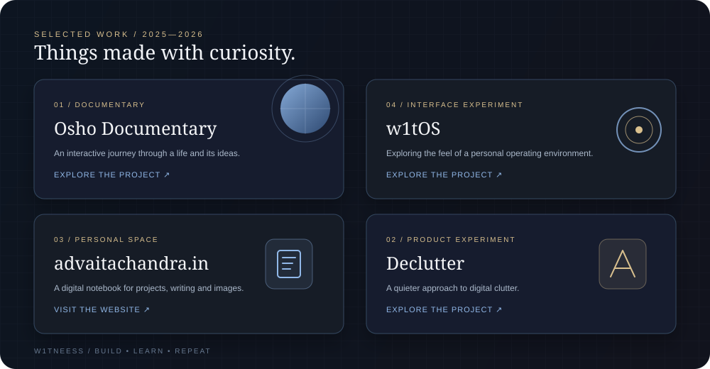

 

  

[ABOUT](#about) &nbsp;·&nbsp; [SELECTED WORK](#selected-work) &nbsp;·&nbsp; [TOOLKIT](#toolkit) &nbsp;·&nbsp; [ELSEWHERE](#outside-the-editor)

---

## About

I'm a student and developer from India interested in the space between **software, philosophy, history and visual storytelling**.

I build websites, experiment with interfaces, and make tools around problems I encounter. This profile is a record of things made, ideas explored, and experiments still in progress.

<strong>A little more</strong>

I enjoy taking an idea from a rough thought to something usable. Most of my learning happens by building, breaking, investigating, and rebuilding.

I'm drawn to thoughtful interfaces, creative technology, and the details that make software feel considered.

## Selected work

| PROJECT | WHAT IT IS | LINKS |
|:--|:--|:--|
| **Osho Documentary** | Interactive documentary exploring a life, timeline and ideas | [Live ↗](https://oshodocumentary.advaitachandra.in/) · [Code ↗](https://github.com/w1tneess/osho-documentary) |
| **Declutter** | A product experiment focused on making digital life simpler | [Live ↗](https://declutter.advaitachandra.in/) · [Code ↗](https://github.com/w1tneess/declutter) |
| **Personal website** | My digital notebook for projects, writing and photography | [Visit ↗](https://advaitachandra.in/) · [Code ↗](https://github.com/w1tneess/advaita-website) |
| **w1tOS** | An interface experiment around a personal operating environment | [Code ↗](https://github.com/w1tneess/w1tos-ui) |
| **Command Deck** | A project in the personal-tools and workflow space | [Code ↗](https://github.com/w1tneess/command-deck) |

[EXPLORE ALL REPOSITORIES ↗](https://github.com/w1tneess?tab=repositories)

## Toolkit

**LANGUAGES**

  

**FRAMEWORKS & TOOLS**

## Outside the editor

Philosophy, photography, books, music, history, and the occasional rabbit hole that turns into a project.

<a href="https://github.com/w1tneess?tab=overview">VIEW GITHUB ACTIVITY ↗</a>
&nbsp;·&nbsp;
<a href="https://github.com/w1tneess?tab=stars">BROWSE MY STARS ↗</a>

  

STILL LEARNING. STILL MAKING. ALWAYS A WORK IN PROGRESS.

