 

## About

Student and developer from India, somewhere between software, philosophy and history. I build websites, useful little tools and interactive archives, and keep a public notebook of what I am reading.

## Stack

## Selected work

<table width="100%">
<tr>
<td width="50%" valign="top"> &nbsp;&nbsp;  </td>
<td width="50%" valign="top"> &nbsp;&nbsp;  </td>
</tr>
<tr>
<td width="50%" valign="top"> &nbsp;&nbsp;  </td>
<td width="50%" valign="top"> &nbsp;&nbsp;  </td>
</tr>
<tr>
<td width="50%" valign="top">   </td>
<td width="50%" valign="top">   </td>
</tr>
</table>

## GitHub

<table width="100%">
<tr>
<td width="50%" valign="top"></td>
<td width="50%" valign="top"></td>
</tr>
</table>

## Contact

<table width="100%">
<tr>
<td width="50%"></td>
<td width="50%"></td>
</tr>
<tr>
<td width="50%"></td>
<td width="50%"></td>
</tr>
</table>

Questions welcome. Ideas better.

