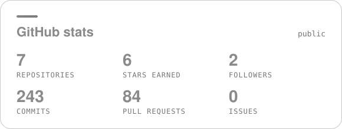

<h1 data-importer="text" align="center">Advaita Chandra</h1>

<h3 data-importer="text" align="center">w1tneess · student · builder · explorer</h3>

<i>Building small things. Keeping the questions open.</i>

  
  
  
  
  

<h2 data-importer="text" align="left">About</h2>

Student and developer from India, somewhere between software, philosophy and history. I build websites, useful little tools and interactive archives, and keep a public notebook of what I am reading.

<h2 data-importer="text" align="left">Stack</h2>

  
  
  
  
  
  
  
  
  
  
  
  
  
  
  
  
  
  
  
  
  
  
  
  
  
  
  

<h2 data-importer="text" align="left">Selected work</h2>

<a href="https://oshodocumentary.advaitachandra.in/"><b>Osho Documentary</b></a> · Evidence-graded archive on Osho and Rajneeshpuram, with timeline and map. <i>Next.js, TypeScript</i> 
<a href="https://declutter.advaitachandra.in/"><b>Declutter</b></a> · Windows app that sorts a messy folder and finds duplicates, previewing first. <i>Python</i> 
<a href="https://www.advaitachandra.in/"><b>advaitachandra.in</b></a> · Personal site and public notebook. <i>React, Vite, Supabase</i> 
<a href="https://support.advaitachandra.in/"><b>Support page</b></a> · Zero-fee UPI page to support independent work. <i>JavaScript</i> 
<a href="https://github.com/w1tneess/w1tos-ui"><b>w1tOS</b></a> · Dark, keyboard-first web UI for CasaOS home servers. <i>Vue</i> 
<a href="https://github.com/w1tneess/command-deck"><b>Command Deck</b></a> · Exam and syllabus study dashboard. <i>TypeScript, Cloudflare Workers</i>

<h2 data-importer="text" align="left">GitHub</h2>

  
  

