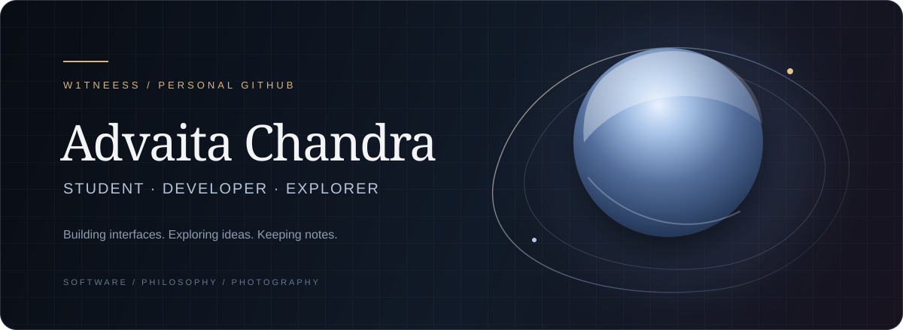

 

 

 

[ABOUT](#about) · [PROJECTS](#selected-work) · [TECH STACK](#technology) · [GITHUB ACTIVITY](#github-activity) · [BEYOND CODE](#outside-the-editor)

---

## About

I'm a student and developer from India interested in the space between **software, philosophy, history and visual storytelling**.

I build websites, experiment with interfaces, and make tools around problems I encounter. This profile is a record of things made, ideas explored, and experiments still in progress.

<strong>More about how I work</strong>

I enjoy taking an idea from a rough thought to something usable. Most of my learning happens by building, breaking, investigating, and rebuilding.

I'm especially interested in thoughtful interfaces, creative technology, and the details that make software feel considered.

## Selected work

A few things I've made or explored. Open a card to visit its project.

<strong>Project links & live experiences</strong>

| Project | Explore |
|:--|:--|
| **Osho Documentary** | [Live experience](https://oshodocumentary.advaitachandra.in/) · [Source](https://github.com/w1tneess/osho-documentary) |
| **Declutter** | [Live experience](https://declutter.advaitachandra.in/) · [Source](https://github.com/w1tneess/declutter) |
| **Personal website** | [Visit](https://advaitachandra.in/) · [Source](https://github.com/w1tneess/advaita-website) |
| **w1tOS** | [Source](https://github.com/w1tneess/w1tos-ui) |
| **Command Deck** | [Source](https://github.com/w1tneess/command-deck) |

[Browse all repositories →](https://github.com/w1tneess?tab=repositories)

## Technology

**LANGUAGES & CORE**

  

**FRAMEWORKS & TOOLS**

<strong>What I'm curious to explore next</strong>

Creative development, 3D on the web, thoughtful product design, developer tooling, and the intersection of technology and storytelling.

## GitHub activity

 

  

## Outside the editor

Philosophy, photography, books, music, history, and the occasional rabbit hole that turns into a project.

[Website](https://advaitachandra.in) · [Repositories](https://github.com/w1tneess?tab=repositories) · [Stars](https://github.com/w1tneess?tab=stars)

 

Still learning. Still making. Always a work in progress.

