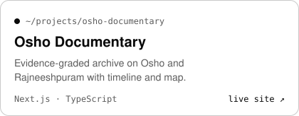
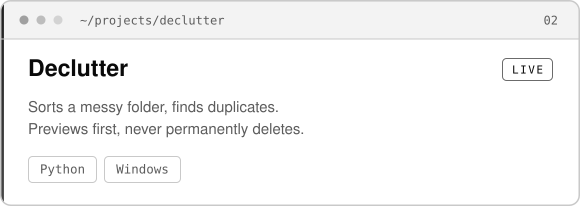
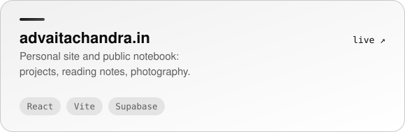
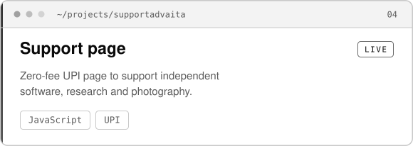
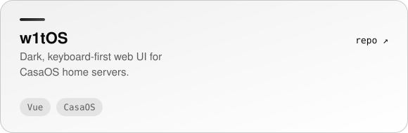
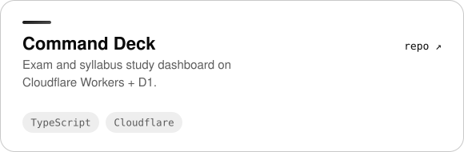

<a href="https://www.advaitachandra.in"><picture><source media="(prefers-color-scheme: dark)" srcset="assets/hero-dark.svg"></picture></a>

<a href="https://www.advaitachandra.in"><picture><source media="(prefers-color-scheme: dark)" srcset="assets/btn-website-dark.svg"></picture></a>&nbsp;<a href="https://x.com/w1tneess_"><picture><source media="(prefers-color-scheme: dark)" srcset="assets/btn-x-dark.svg"></picture></a>&nbsp;<a href="https://www.instagram.com/adva1ta_/"><picture><source media="(prefers-color-scheme: dark)" srcset="assets/btn-instagram-dark.svg"></picture></a>&nbsp;<a href="mailto:hi@advaitachandra.in"><picture><source media="(prefers-color-scheme: dark)" srcset="assets/btn-email-dark.svg"></picture></a>&nbsp;<a href="https://support.advaitachandra.in/"><picture><source media="(prefers-color-scheme: dark)" srcset="assets/btn-support-dark.svg"></picture></a>

Student and developer from India, somewhere between software, philosophy and history. I build websites, useful little tools and interactive archives, and keep a public notebook of what I am reading.

<h2 data-importer="text" align="left">What I do</h2>

- **Software**: websites and useful little tools
- **History**: archives that grade their evidence, with timelines and maps
- **Philosophy**: a public notebook of what I am reading
- **Photography**: kept on the site, next to the notes

<h2 data-importer="text" align="left">Stack</h2>

TypeScript, JavaScript, Python, C#, HTML, CSS &nbsp;·&nbsp; React, Vue, Vite, Tailwind CSS &nbsp;·&nbsp; Node.js, Supabase, Cloudflare &nbsp;·&nbsp; Git

<h2 data-importer="text" align="left">Selected work</h2>

<!-- One table per row: GitHub tints every second row of a table. The cell border is the card. -->
<table width="100%"><tr>
<td width="50%" valign="top"><a href="https://oshodocumentary.advaitachandra.in/"><picture><source media="(prefers-color-scheme: dark)" srcset="assets/card-osho-dark.svg"></picture></a> <a href="https://oshodocumentary.advaitachandra.in/"><picture><source media="(prefers-color-scheme: dark)" srcset="assets/btn-live-dark.svg"></picture></a>&nbsp;&nbsp;<a href="https://github.com/w1tneess/osho-documentary"><picture><source media="(prefers-color-scheme: dark)" srcset="assets/btn-source-dark.svg"></picture></a></td>
<td width="50%" valign="top"><a href="https://declutter.advaitachandra.in/"><picture><source media="(prefers-color-scheme: dark)" srcset="assets/card-declutter-dark.svg"></picture></a> <a href="https://declutter.advaitachandra.in/"><picture><source media="(prefers-color-scheme: dark)" srcset="assets/btn-live-dark.svg"></picture></a>&nbsp;&nbsp;<a href="https://github.com/w1tneess/declutter"><picture><source media="(prefers-color-scheme: dark)" srcset="assets/btn-source-dark.svg"></picture></a></td>
</tr></table>

<table width="100%"><tr>
<td width="50%" valign="top"><a href="https://www.advaitachandra.in/"><picture><source media="(prefers-color-scheme: dark)" srcset="assets/card-site-dark.svg"></picture></a> <a href="https://www.advaitachandra.in/"><picture><source media="(prefers-color-scheme: dark)" srcset="assets/btn-live-dark.svg"></picture></a>&nbsp;&nbsp;<a href="https://github.com/w1tneess/advaita-website"><picture><source media="(prefers-color-scheme: dark)" srcset="assets/btn-source-dark.svg"></picture></a></td>
<td width="50%" valign="top"><a href="https://support.advaitachandra.in/"><picture><source media="(prefers-color-scheme: dark)" srcset="assets/card-support-dark.svg"></picture></a> <a href="https://support.advaitachandra.in/"><picture><source media="(prefers-color-scheme: dark)" srcset="assets/btn-live-dark.svg"></picture></a>&nbsp;&nbsp;<a href="https://github.com/w1tneess/supportadvaita"><picture><source media="(prefers-color-scheme: dark)" srcset="assets/btn-source-dark.svg"></picture></a></td>
</tr></table>

<table width="100%"><tr>
<td width="50%" valign="top"><a href="https://github.com/w1tneess/w1tos-ui"><picture><source media="(prefers-color-scheme: dark)" srcset="assets/card-w1tos-dark.svg"></picture></a> <a href="https://github.com/w1tneess/w1tos-ui"><picture><source media="(prefers-color-scheme: dark)" srcset="assets/btn-source-dark.svg"></picture></a></td>
<td width="50%" valign="top"><a href="https://github.com/w1tneess/command-deck"><picture><source media="(prefers-color-scheme: dark)" srcset="assets/card-deck-dark.svg"></picture></a> <a href="https://github.com/w1tneess/command-deck"><picture><source media="(prefers-color-scheme: dark)" srcset="assets/btn-source-dark.svg"></picture></a></td>
</tr></table>

<h2 data-importer="text" align="left">GitHub</h2>

  <picture><source media="(prefers-color-scheme: dark)" srcset="https://raw.githubusercontent.com/w1tneess/w1tneess/stats-output/activity-dark.svg" /></picture>

  <picture><source media="(prefers-color-scheme: dark)" srcset="https://raw.githubusercontent.com/w1tneess/w1tneess/stats-output/stats-dark.svg" /></picture>
  <picture><source media="(prefers-color-scheme: dark)" srcset="https://raw.githubusercontent.com/w1tneess/w1tneess/stats-output/languages-dark.svg" /></picture>

<h2 align="left">How <a href="https://github.com/w1tneess/advaita-website">advaita-website</a> works</h2>

A personal portfolio and public notebook built with React 19 and Vite. Pages read through a content store that syncs with Supabase and falls back to seed data; an admin studio edits it.

<a href="https://github.com/w1tneess/advaita-website"><picture><source media="(prefers-color-scheme: dark)" srcset="assets/arch-dark.svg"></picture></a>

Structure traced from the code by <a href="https://www.gitskins.com">GitSkins</a>

<h2 data-importer="text" align="left">Let's connect</h2>

Reading notes, projects and photography live at <a href="https://www.advaitachandra.in">advaitachandra.in</a>. If something here helped you, the support page keeps it independent.

<a href="https://www.advaitachandra.in"><picture><source media="(prefers-color-scheme: dark)" srcset="assets/btn-website-dark.svg"></picture></a>&nbsp;<a href="https://x.com/w1tneess_"><picture><source media="(prefers-color-scheme: dark)" srcset="assets/btn-x-dark.svg"></picture></a>&nbsp;<a href="https://www.instagram.com/adva1ta_/"><picture><source media="(prefers-color-scheme: dark)" srcset="assets/btn-instagram-dark.svg"></picture></a>&nbsp;<a href="mailto:hi@advaitachandra.in"><picture><source media="(prefers-color-scheme: dark)" srcset="assets/btn-email-dark.svg"></picture></a>&nbsp;<a href="https://support.advaitachandra.in/"><picture><source media="(prefers-color-scheme: dark)" srcset="assets/btn-support-dark.svg"></picture></a>

