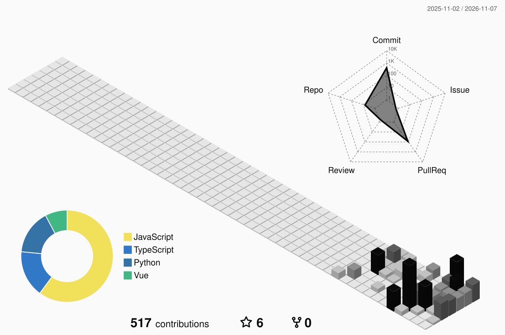

<a href="https://www.advaitachandra.in"></a>

<p data-importer="socials" align="center">
  <a href="https://www.advaitachandra.in">advaitachandra.in</a> ·
  <a href="https://x.com/w1tneess_">X</a> ·
  <a href="mailto:hi@advaitachandra.in">Email</a> ·
  <a href="https://support.advaitachandra.in/">Support</a>
</p>

<p align="center">Student and developer from India, somewhere between software, philosophy and history.<br>I build websites, useful little tools and interactive archives, and keep a public notebook of what I am reading.</p>

<h2 data-importer="text" align="left">What I do</h2>

```js
const advaita = {
  handle: "w1tneess",
  based: "India",
  role: "student & developer",
  between: ["software", "philosophy", "history"],
  builds: ["websites", "useful little tools", "interactive archives"],
  notebook: "advaitachandra.in",
  questions: "kept open",
};
```

<h2 data-importer="text" align="left">Focus areas</h2>

```text
▸ Software      → websites and useful little tools
▸ History       → archives that grade their evidence, with timelines and maps
▸ Philosophy    → a public notebook of what I am reading
▸ Photography   → kept on the site, next to the notes
```

<h2 data-importer="text" align="left">Stack</h2>

<h4 align="left">Languages</h4>
<div data-importer="techs" align="left">
  
  
  
  
  
  
  
  
  
  
  
</div>

<h4 align="left">Frontend</h4>
<div data-importer="techs" align="left">
  
  
  
  
  
  
  
</div>

<h4 align="left">Backend and cloud</h4>
<div data-importer="techs" align="left">
  
  
  
  
  
</div>

<h4 align="left">Tools</h4>
<div data-importer="techs" align="left">
  
</div>

<h2 data-importer="text" align="left">Selected work</h2>

<!-- One table per row: GitHub tints every second row of a table. The cell border is the card. -->
<table width="100%"><tr>
<td width="50%" valign="top"><a href="https://oshodocumentary.advaitachandra.in/"></a><br><a href="https://oshodocumentary.advaitachandra.in/"></a>&nbsp;&nbsp;<a href="https://github.com/w1tneess/osho-documentary"></a></td>
<td width="50%" valign="top"><a href="https://declutter.advaitachandra.in/"></a><br><a href="https://declutter.advaitachandra.in/"></a>&nbsp;&nbsp;<a href="https://github.com/w1tneess/declutter"></a></td>
</tr></table>

<table width="100%"><tr>
<td width="50%" valign="top"><a href="https://www.advaitachandra.in/"></a><br><a href="https://www.advaitachandra.in/"></a>&nbsp;&nbsp;<a href="https://github.com/w1tneess/advaita-website"></a></td>
<td width="50%" valign="top"><a href="https://support.advaitachandra.in/"></a><br><a href="https://support.advaitachandra.in/"></a>&nbsp;&nbsp;<a href="https://github.com/w1tneess/supportadvaita"></a></td>
</tr></table>

<table width="100%"><tr>
<td width="50%" valign="top"><a href="https://github.com/w1tneess/w1tos-ui"></a><br><a href="https://github.com/w1tneess/w1tos-ui"></a></td>
<td width="50%" valign="top"><a href="https://github.com/w1tneess/command-deck"></a><br><a href="https://github.com/w1tneess/command-deck"></a></td>
</tr></table>

<h2 data-importer="text" align="left">GitHub</h2>

<p align="center">
  <picture>
    <source media="(prefers-color-scheme: dark)" srcset="https://raw.githubusercontent.com/w1tneess/w1tneess/skyline-output/skyline-dark.svg" />
    
  </picture>
</p>

<p data-importer="stats" align="center">
  <picture><source media="(prefers-color-scheme: dark)" srcset="https://raw.githubusercontent.com/w1tneess/w1tneess/stats-output/stats-dark.svg" /></picture>
  <picture><source media="(prefers-color-scheme: dark)" srcset="https://raw.githubusercontent.com/w1tneess/w1tneess/stats-output/languages-dark.svg" /></picture>
</p>

<p align="center">
  <picture>
    <source media="(prefers-color-scheme: dark)" srcset="https://streak-stats.demolab.com/?user=w1tneess&background=0a0a0a&border=232323&border_radius=16&ring=8f8f8f&fire=8f8f8f&currStreakNum=f0f0f0&sideNums=f0f0f0&currStreakLabel=f0f0f0&sideLabels=f0f0f0&dates=8f8f8f&stroke=2a2a2a" />
    
  </picture>
</p>


<h3 align="left">How <a href="https://github.com/w1tneess/advaita-website">advaita-website</a> works</h3>

<p>A personal portfolio and public notebook built with React 19 and Vite. Pages read through a content store that syncs with Supabase and falls back to seed data; an admin studio edits it.</p>

<a href="https://github.com/w1tneess/advaita-website"></a>

<sub>Structure traced from the code by <a href="https://www.gitskins.com">GitSkins</a></sub>

<h2 data-importer="text" align="left">Let's connect</h2>

<p>Reading notes, projects and photography live at <a href="https://www.advaitachandra.in">advaitachandra.in</a>.<br>Say hi at <a href="mailto:hi@advaitachandra.in">hi@advaitachandra.in</a> or on <a href="https://x.com/w1tneess_">X</a>. If something here helped you, the <a href="https://support.advaitachandra.in/">support page</a> keeps it independent.</p>
