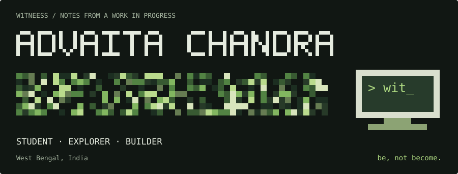
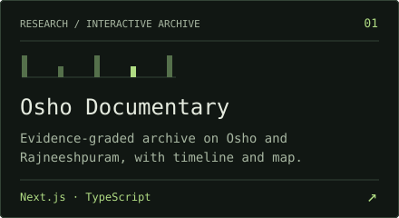
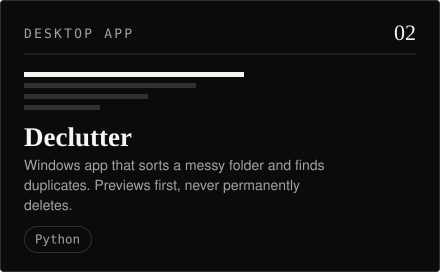
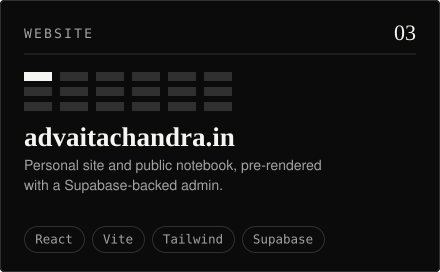
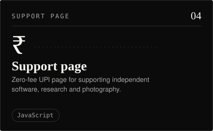

<div align="center">
  <a href="https://www.advaitachandra.in/"></a>
  <p>
    <a href="#selected-work"></a>
    <a href="#field-notes"></a>
    <a href="https://www.advaitachandra.in/philosophy"></a>
    <a href="https://www.advaitachandra.in/photography"></a>
    <a href="#contact"></a>
  </p>
</div>

<h2><a name="right-now"></a><picture><source media="(prefers-color-scheme: dark)" srcset="assets/headings/right-now-dark.svg"></picture></h2>

<!--NOW:START-->
*Reading Krishnamurti against cognitive psychology, and asking whether the "silent observer" is just another narrator.*
<!--NOW:END-->

<h2><a name="selected-work"></a><picture><source media="(prefers-color-scheme: dark)" srcset="assets/headings/selected-work-dark.svg"></picture></h2>

<table>
  <tr>
    <td width="50%" align="left" valign="top">
      <a href="https://oshodocumentary.advaitachandra.in/"></a><br>
      <a href="https://oshodocumentary.advaitachandra.in/"></a>
      <a href="https://github.com/w1tneess/osho-documentary"></a>
    </td>
    <td width="50%" align="left" valign="top">
      <a href="https://declutter.advaitachandra.in/"></a><br>
      <a href="https://declutter.advaitachandra.in/"></a>
      <a href="https://github.com/w1tneess/declutter"></a>
    </td>
  </tr>
  <tr>
    <td width="50%" align="left" valign="top">
      <a href="https://www.advaitachandra.in/"></a><br>
      <a href="https://www.advaitachandra.in/"></a>
      <a href="https://github.com/w1tneess/advaita-website"></a>
    </td>
    <td width="50%" align="left" valign="top">
      <a href="https://support.advaitachandra.in/"></a><br>
      <a href="https://support.advaitachandra.in/"></a>
      <a href="https://github.com/w1tneess/supportadvaita"></a>
    </td>
  </tr>
</table>

<p>More, including data-visualisation and system-design work, on the <a href="https://www.advaitachandra.in/projects">projects page</a>.</p>

<h2><a name="current-explorations"></a><picture><source media="(prefers-color-scheme: dark)" srcset="assets/headings/explorations-dark.svg"></picture></h2>

The most recently pushed public repositories, read from GitHub.

<!--ACTIVITY:START-->
<table>
<tr>
<td width="50%" valign="top">
<a href="https://github.com/w1tneess/supportadvaita"><picture><source media="(prefers-color-scheme: dark)" srcset="assets/generated/repo-1-7bf21383-dark.svg"></picture></a><br>
Merge pull request #1 from w1tneess/audit/payment-compl…
</td>
<td width="50%" valign="top">
<a href="https://github.com/w1tneess/advaita-website"><picture><source media="(prefers-color-scheme: dark)" srcset="assets/generated/repo-2-d9f0e068-dark.svg"></picture></a><br>
fix: sync Vite 8 lockfile and dependencies
</td>
</tr>
<tr>
<td width="50%" valign="top">
<a href="https://github.com/w1tneess/declutter"><picture><source media="(prefers-color-scheme: dark)" srcset="assets/generated/repo-3-f86b8a1b-dark.svg"></picture></a><br>
Merge pull request #19 from w1tneess/fix-duplicate-supp…
</td>
<td width="50%" valign="top">
<a href="https://github.com/w1tneess/osho-documentary"><picture><source media="(prefers-color-scheme: dark)" srcset="assets/generated/repo-4-3dd2b994-dark.svg"></picture></a><br>
chore(deps): bump @typescript-eslint/parser to 8.71.2 (…
</td>
</tr>
</table>
<!--ACTIVITY:END-->

<h2><a name="field-notes"></a><picture><source media="(prefers-color-scheme: dark)" srcset="assets/headings/field-notes-dark.svg"></picture></h2>

<!--WRITING:START-->
<a href="https://advaitachandra.in/philosophy#note-krishnamurti-observer"><picture><source media="(prefers-color-scheme: dark)" srcset="assets/generated/note-1-1220c730-dark.svg"></picture></a>

<a href="https://advaitachandra.in/philosophy#note-camus-absurd"><picture><source media="(prefers-color-scheme: dark)" srcset="assets/generated/note-2-75ab4545-dark.svg"></picture></a>

<a href="https://advaitachandra.in/philosophy#note-dostoevsky-underground"><picture><source media="(prefers-color-scheme: dark)" srcset="assets/generated/note-3-baa4f1d8-dark.svg"></picture></a>
<!--WRITING:END-->

Working through Krishnamurti, Camus, Dostoevsky, Ramana Maharshi and Osho.

<p>
  <a href="https://www.advaitachandra.in/philosophy"><strong>Full notebook ↗</strong></a> &nbsp;/&nbsp;
  <a href="https://www.advaitachandra.in/blog">Writing ↗</a> &nbsp;/&nbsp;
  <a href="https://www.advaitachandra.in/art">Algorithmic art ↗</a> &nbsp;/&nbsp;
  <a href="https://www.advaitachandra.in/rss.xml">RSS ↗</a>
</p>

<h2><a name="contact"></a><picture><source media="(prefers-color-scheme: dark)" srcset="assets/headings/contact-dark.svg"></picture></h2>

<p>
  <a href="https://www.advaitachandra.in/contact" aria-label="Contact form on advaitachandra.in">Website ↗</a> &nbsp;/&nbsp;
  <a href="mailto:hi@advaitachandra.in" aria-label="Email hi@advaitachandra.in">Email ↗</a> &nbsp;/&nbsp;
  <a href="https://x.com/w1tneess_" aria-label="w1tneess on X">X ↗</a> &nbsp;/&nbsp;
  <a href="https://instagram.com/adva1ta_" aria-label="adva1ta_ on Instagram">Instagram ↗</a> &nbsp;/&nbsp;
  <a href="https://github.com/w1tneess" aria-label="w1tneess on GitHub">GitHub ↗</a>
</p>

<br>

<a href="https://support.advaitachandra.in"></a>

<hr>

<details>
<summary><code>~/w1tneess $ ls -a</code></summary>

```console
$ ls -a
.  ..  .method  .doubts  about.txt  now.md

$ cat .method
read the source, not the summary
sort every claim into four bins:
  verified · inferred · opinion · unknown

$ cat .doubts
the fourth bin is the honest one.

$ cat about.txt
student, West Bengal.
builds websites, keeps a public notebook on
philosophy, history, photography, creative computing.
```

</details>

<div align="right">

<!--STAMP:START-->
<sub>Generated 17 Oct 2026 by <a href="https://github.com/w1tneess/w1tneess/blob/main/.github/workflows/update.yml">a scheduled action</a></sub>
<!--STAMP:END-->

</div>
