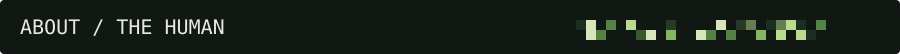
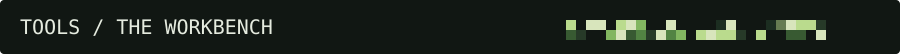
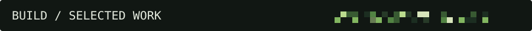
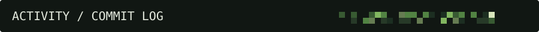
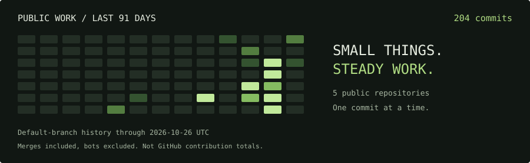
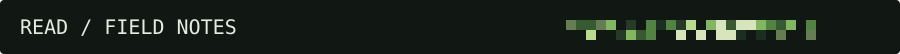
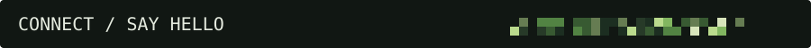
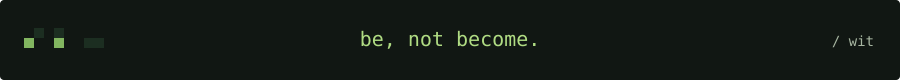

<div align="center">
<a href="https://www.advaitachandra.in/"><picture><source media="(max-width: 600px)" srcset="assets/hero-mobile.svg"></picture></a>

**Building small things. Keeping the questions open.**

[Website](https://www.advaitachandra.in/) &nbsp; / &nbsp; [Projects](#selected-work) &nbsp; / &nbsp; [Photography](https://www.advaitachandra.in/photography) &nbsp; / &nbsp; [Notebook](#field-notes)
</div>

<h2><picture><source media="(max-width: 600px)" srcset="assets/section-about-mobile.svg"></picture></h2>

Hey, I'm **Advaita** — also **Wit**. A student from West Bengal, somewhere between software, philosophy, and history.

- **I build** websites, useful little tools, and interactive archives.
- **I explore** how things work — from a line of code to the mind reading it.
- **Beyond code:** photography, reading, and questions I haven't fully worked out yet.

<details open>
<summary><b>On my desk right now</b></summary>

<!--NOW:START-->
Reading Krishnamurti against cognitive psychology, and asking whether the &quot;silent observer&quot; is just another narrator.
<!--NOW:END-->

</details>

<h2><picture><source media="(max-width: 600px)" srcset="assets/section-stack-mobile.svg"></picture></h2>

Tools I use across my projects. Still learning as I build.

<table>
<tr>
<td align="center" width="25%"><br><sub>TypeScript</sub></td>
<td align="center" width="25%"><br><sub>JavaScript</sub></td>
<td align="center" width="25%"><br><sub>Python</sub></td>
<td align="center" width="25%"><br><sub>HTML</sub></td>
</tr>
<tr>
<td align="center" width="25%"><br><sub>CSS</sub></td>
<td align="center" width="25%"><br><sub>React</sub></td>
<td align="center" width="25%"><br><sub>Next.js</sub></td>
<td align="center" width="25%"><br><sub>Vite</sub></td>
</tr>
<tr>
<td align="center" width="25%"><br><sub>Tailwind CSS</sub></td>
<td align="center" width="25%"><br><sub>Supabase</sub></td>
<td align="center" width="25%"><br><sub>Node.js</sub></td>
<td align="center" width="25%"><br><sub>Git</sub></td>
</tr>
</table>

<a id="selected-work"></a>
<h2><picture><source media="(max-width: 600px)" srcset="assets/section-projects-mobile.svg"></picture></h2>

<table>
<tr>
<td width="50%" valign="top"><a href="https://oshodocumentary.advaitachandra.in/"><picture><source media="(max-width: 600px)" srcset="assets/card-osho-documentary-mobile.svg"></picture></a><br><sub><a href="https://oshodocumentary.advaitachandra.in/">Explore ↗&#xFE0E;</a> · <a href="https://github.com/w1tneess/osho-documentary">Source ↗&#xFE0E;</a></sub></td>
<td width="50%" valign="top"><a href="https://declutter.advaitachandra.in/"><picture><source media="(max-width: 600px)" srcset="assets/card-declutter-mobile.svg"></picture></a><br><sub><a href="https://declutter.advaitachandra.in/">Explore ↗&#xFE0E;</a> · <a href="https://github.com/w1tneess/declutter">Source ↗&#xFE0E;</a></sub></td>
</tr>
<tr>
<td width="50%" valign="top"><a href="https://www.advaitachandra.in/"><picture><source media="(max-width: 600px)" srcset="assets/card-advaita-website-mobile.svg"></picture></a><br><sub><a href="https://www.advaitachandra.in/">Explore ↗&#xFE0E;</a> · <a href="https://github.com/w1tneess/advaita-website">Source ↗&#xFE0E;</a></sub></td>
<td width="50%" valign="top"><a href="https://support.advaitachandra.in/"><picture><source media="(max-width: 600px)" srcset="assets/card-supportadvaita-mobile.svg"></picture></a><br><sub><a href="https://support.advaitachandra.in/">Explore ↗&#xFE0E;</a> · <a href="https://github.com/w1tneess/supportadvaita">Source ↗&#xFE0E;</a></sub></td>
</tr>
</table>

[More from the archive ↗&#xFE0E;](https://www.advaitachandra.in/projects)

<h2><picture><source media="(max-width: 600px)" srcset="assets/section-activity-mobile.svg"></picture></h2>

<a href="https://github.com/w1tneess?tab=repositories"><picture><source media="(max-width: 600px)" srcset="assets/activity-mobile.svg"></picture></a>

<details>
<summary>Recent commits</summary>

<!--ACTIVITY:START-->
<ul>
<li><a href="https://github.com/w1tneess/declutter">declutter</a> — Bump version to 0.2.2 <a href="https://github.com/w1tneess/declutter/commit/7a62acdb26f0d18b729e34d799d55a5fe00739f7">(20 Oct 2026)</a></li>
<li><a href="https://github.com/w1tneess/advaita-website">advaita-website</a> — refactor(content): drop the temporary table-read fallback for the public RPC <a href="https://github.com/w1tneess/advaita-website/commit/34335c3923a2b17e905952b6db67f6094767763a">(19 Oct 2026)</a></li>
<li><a href="https://github.com/w1tneess/supportadvaita">supportadvaita</a> — fix(wrangler): add previews block for Workers Builds branch previews <a href="https://github.com/w1tneess/supportadvaita/commit/6ff7052950261ef53e6b7355edfb56b66510a959">(17 Oct 2026)</a></li>
<li><a href="https://github.com/w1tneess/osho-documentary">osho-documentary</a> — chore(deps): bump @typescript-eslint/parser to 8.71.2 (#16) <a href="https://github.com/w1tneess/osho-documentary/commit/4bf36556a49e9c4e64a1ec21b9b7d56d16071777">(16 Oct 2026)</a></li>
</ul>
<!--ACTIVITY:END-->

</details>

<a id="field-notes"></a>
<h2><picture><source media="(max-width: 600px)" srcset="assets/section-notes-mobile.svg"></picture></h2>

Notes on books I'm reading and questions I haven't solved yet: Krishnamurti, Camus, Dostoevsky, Ramana Maharshi and Osho.

<!--WRITING:START-->
<ol>
<li><a href="https://advaitachandra.in/philosophy/krishnamurti-observer">On Krishnamurti and the Mechanics of the Observer</a> — 14 Nov 2025</li>
<li><a href="https://advaitachandra.in/philosophy/camus-absurd">Camus: The Absurd as an Epistemic Baseline</a> — 2 Oct 2025</li>
<li><a href="https://advaitachandra.in/philosophy/dostoevsky-underground">Dostoevsky on Rational Egoism and Irrational Will</a> — 19 Aug 2025</li>
</ol>
<!--WRITING:END-->

[Philosophy ↗&#xFE0E;](https://www.advaitachandra.in/philosophy) &nbsp; · &nbsp; [Writing ↗&#xFE0E;](https://www.advaitachandra.in/blog) &nbsp; · &nbsp; [Algorithmic art ↗&#xFE0E;](https://www.advaitachandra.in/art) &nbsp; · &nbsp; [RSS](https://www.advaitachandra.in/rss.xml)

<h2><picture><source media="(max-width: 600px)" srcset="assets/section-contact-mobile.svg"></picture></h2>

A question, an idea, or something worth sharing — I'm around.

**[Email ↗&#xFE0E;](mailto:hi@advaitachandra.in)** &nbsp; / &nbsp; **[Website ↗&#xFE0E;](https://www.advaitachandra.in/contact)** &nbsp; / &nbsp; **[Instagram ↗&#xFE0E;](https://instagram.com/adva1ta_)** &nbsp; / &nbsp; **[X ↗&#xFE0E;](https://x.com/w1tneess_)**

[Support my independent work ↗&#xFE0E;](https://support.advaitachandra.in/)

<br>

<picture><source media="(max-width: 600px)" srcset="assets/footer-mobile.svg"></picture>

<details>
<summary><code>~/w1tneess $ ls -a</code></summary>

```console
$ ls -a
.  ..  .method  .doubts  about.txt  now.md

$ cat .method
read the source, not the summary
sort every claim into four bins:
  verified · inferred · opinion · unknown

$ cat .doubts
the fourth bin is the honest one.

$ cat about.txt
student, West Bengal.
builds websites, keeps a public notebook on
philosophy, history, photography, creative computing.
```

</details>

<!--STAMP:START-->
<sub>Activity and writing refresh automatically; unavailable sources keep their last successful content.</sub>
<!--STAMP:END-->
